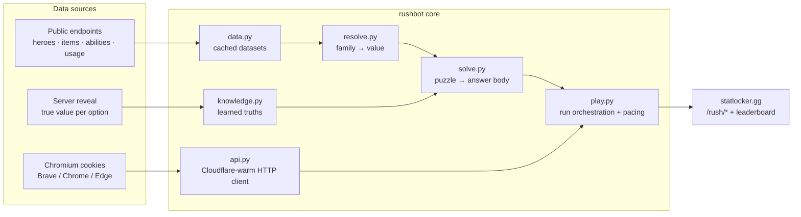
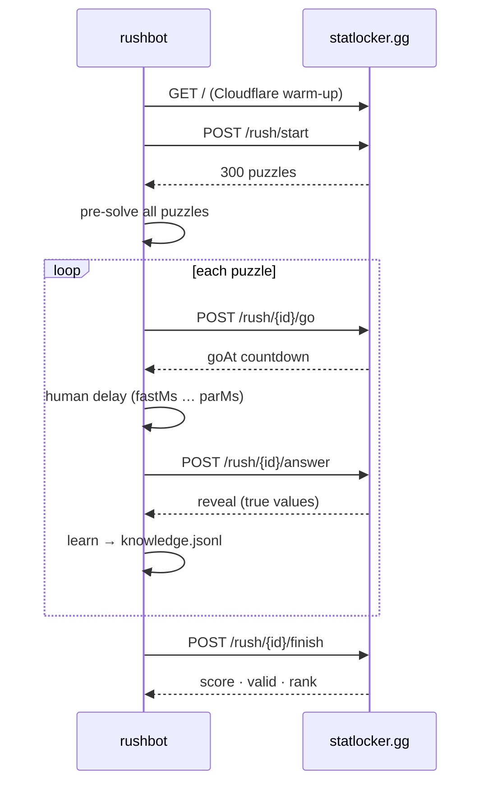

<div align="center">

```
██████╗ ██╗   ██╗███████╗██╗  ██╗██████╗  ██████╗ ████████╗
██╔══██╗██║   ██║██╔════╝██║  ██║██╔══██╗██╔═══██╗╚══██╔══╝
██████╔╝██║   ██║███████╗███████║██████╔╝██║   ██║   ██║
██╔══██╗██║   ██║╚════██║██╔══██║██╔══██╗██║   ██║   ██║
██║  ██║╚██████╔╝███████║██║  ██║██████╔╝╚██████╔╝   ██║
╚═╝  ╚═╝ ╚═════╝ ╚══════╝╚═╝  ╚═╝╚═════╝  ╚═════╝    ╚═╝
```

**Statlockle Rush solver & humanized bot** for [statlocker.gg](https://statlocker.gg)

[](https://www.python.org/)
[](https://github.com/SerByte/rushbot/actions/workflows/ci.yml)
[](./LICENSE)
[](#accuracy)
[](#results)

</div>

> Pre-solves every puzzle in the *Statlockle Rush* survival quiz, answers with human-like
> timing so runs survive the server's anti-cheat, and **learns from every reveal it sees**.

---

## ✦ Key numbers

| Accuracy | Top result | Puzzle types | Runtime deps |
|:---:|:---:|:---:|:---:|
| **99.7%** | **#2** — 64 166 pts | **19** | **1** (`cryptography`) |

Raw harvested runs have hit 87 k-class survival; `soulsquares` is the only soft spot
(~82%, bounded by sparse map data).

---

## Table of contents

- [What it does](#what-it-does)
- [Puzzle coverage](#puzzle-coverage)
- [Anti-bot / humanization](#anti-bot--humanization)
- [How it works](#how-it-works)
- [Install](#install)
- [Quick start](#quick-start)
- [CLI reference](#cli-reference)
- [Results](#results)
- [Accuracy](#accuracy)
- [Development](#development)
- [License](#license)

---

## What it does

`rushbot` plays a full run of Statlockle Rush end-to-end, as a state machine:

1. **Starts** a run and pre-solves all 300 puzzles from public datasets.
2. **Answers** each puzzle with the correct body for its type.
3. **Paces** answers like a human — per-puzzle speed window + jitter + hesitation.
4. **Learns** the true value of every option from the server's `reveal` block and reuses it
   later. Fresh reveals override stale cached datasets, so the solver gets *more* accurate
   every run.
5. **Finishes** the run and reports score, strikes, and rank.

---

## Puzzle coverage

| type | how it's solved |
|---|---|
| `pair` · `rank4` · `oddoneout` · `reversepick` · `statpick` · `minimap` | order by the resolved value |
| `overunder` | compare against the line |
| `buckets` | split high/low around the line |
| `estimate` | value snapped to the slider grid (with PP tolerance) |
| `scale` | ratio between reference and target |
| `chain` | **step-by-step** `{step, guess}` — the wire format the server actually accepts |
| `soulsquares` | spatial kNN over learned samples (~82% on unseen pairs; `entityId` encodes map position) |
| `shopdash` · `iconcost` | found-items + human `pickMs` cadence |
| `kitcheck` | ability-slot order from kit icons |
| `abilityorder` | AP order from the ability-order stats |
| `objective` · `last seen` | countable asks + geometric minimap reconstruction |

---

## Anti-bot / humanization

The server flags runs whose *answer times look wrong* (`valid: false` → "Run not ranked").
`rushbot` targets the human middle of each puzzle's speed window:

```python
delay = fastMs + (parMs - fastMs) * U(0.35, 0.65) + 1800ms   # + 10% long stares
```

- `--read-speed fast|normal|slow` scales how fast the bot is seen (slow → higher `solveMult`).
- Chain steps run on the bare countdown (a slow pace blows the whole-chain `parMs`).
- Verification: a fixed play cadence yields `valid: true` in ~10-15% of runs — enough to
  place a high score on the board.

---

## How it works

### Architecture



### Run flow



### Modules

| module | role |
|---|---|
| `api.py` | HTTP client (Cloudflare warm-up, `/rush` endpoints, cookie jar) |
| `data.py` | cached public datasets: heroes, items, abilities, hero/item usage, misc |
| `resolve.py` | family → numeric value per option (the resolver rules) |
| `knowledge.py` | learned `(family, context, entity) → true value`, harvested from reveals |
| `solve.py` | puzzle → answer body |
| `play.py` | run orchestration, pacing, retries, logging |
| `brave.py` | Chromium cookie extraction + DPAPI/AES-GCM decryption |
| `calibrate.py` | accuracy report over harvested samples |

Every value the generator compares comes from a public endpoint; `resolve.py` maps each
family onto the right field. Where the endpoint is only an approximation, `knowledge.py`
overrides it once the server reveals the exact number. Run logs land in `data/runs/*.jsonl`
and double as training data for `calib`/`seed`.

---

## Install

**Windows, one click:** double-click `setup.bat` — it checks Python, installs dependencies and
opens an interactive menu (ASCII UI, no PowerShell needed).

**Manual:**

```bat
python -m pip install -r requirements.txt
python -m rushbot fetch            :: download public datasets
python -m rushbot board            :: current leaderboard
```

Requires **Python 3.10+**. Only external dependency: `cryptography` (cookie decryption on Windows).

---

## Quick start

```bat
:: 1. pull the statlocker session cookie straight from a local browser profile
python -m rushbot brave --browser brave --profile Default

:: 2. solve a saved run payload offline (no network, sanity-check the solver)
python -m rushbot plan start.json

:: 3. play a full run, human-paced
python -m rushbot play --latency --read-speed slow
```

`brave` reads Chromium cookie DBs (Brave / Chrome / Edge) and decrypts them via DPAPI; for a
browser that is currently *open* it falls back to a volume shadow copy.

---

## CLI reference

```
rushbot brave   [--browser brave|chrome|edge] [--profile Default] [--out FILE]
rushbot plan    start.json                 # dry-solve a saved /rush/start payload
rushbot play    [--latency] [--read-speed fast|normal|slow] [--max N] [--delay MS]
rushbot runs    [--runs N] [--latency]
rushbot vigil   [--cookie FILE]            # keep playing until a run finally ranks
rushbot calib   samples.jsonl              # per-family accuracy report
rushbot seed    samples.jsonl              # ingest harvested samples into knowledge
rushbot board                              # season leaderboard top
rushbot fetch                              # refresh cached datasets
rushbot auth    --cookie FILE              # verify a Steam session cookie
```

Key flags:

- `--latency` — human answer pacing (the recommended mode).
- `--read-speed slow` — claim a slow reader: the server permits a larger `solveMult`.
- `--refresh` — re-download public datasets first (they drift).
- `--target N` — stop once the score reaches `N` (default: beat leaderboard #1).
- `--adapt` — tune pacing from the server-reported `solveMs`.

---

## Results

Season 2 leaderboard (illustrative, drifts as the board moves):

| # | account | score |
|---:|---|---:|
| 1 | #мех | 87 071 |
| **2** | **SerByter** | **64 166** |
| 3 | Wormy | 40 411 |
| 4 | IcyRain | 22 497 |

---

## Accuracy

| metric | value |
|---|---|
| Overall (harvested runs) | **99.7%** |
| `soulsquares` (unseen pairs) | **~82%** |
| `soulsquares` (before spatial kNN) | 53% |

The `reveal` block on every answer is a labelling pass: `seed` ingests it, and the next run
solves that triple directly instead of guessing. Accuracy compounds with each harvested run.

---

## Development

The solver core is covered by an offline test suite — no network, browser, or live
server access required.

```bash
python -m pip install -e ".[dev]"

pytest                 # 60 tests: parsing, resolver rules, answer bodies, grading
ruff check rushbot/ tests/   # lint (E/F/W)
```

CI runs lint + tests on Ubuntu and Windows across Python 3.10–3.12.

---

## License

[MIT](./LICENSE) © 2026 SerByte.

> Automated play may violate statlocker.gg's terms of service — point this only at accounts
> you own.
